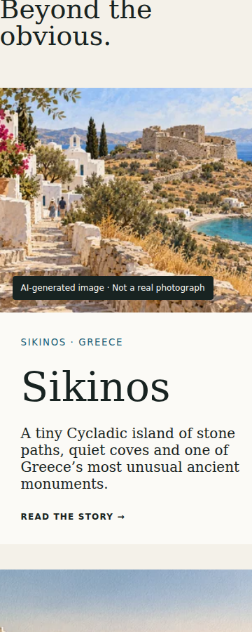
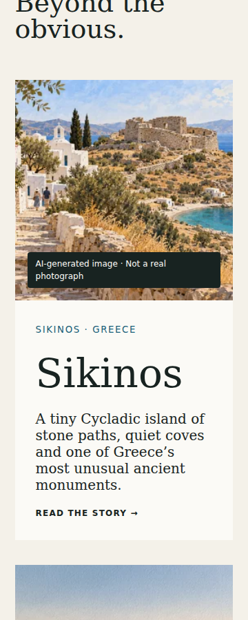
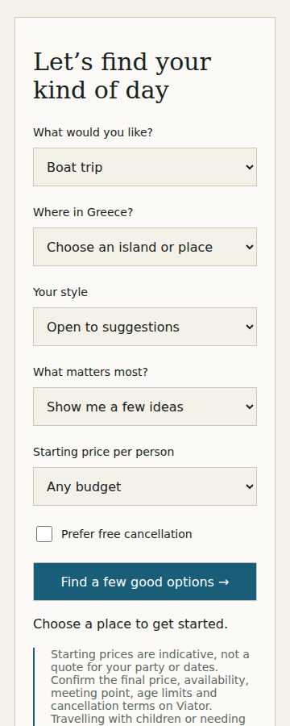
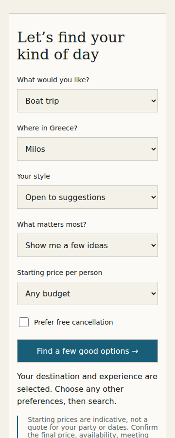

# Первая итерация аудита — проект изменений

Основание: полный `Greece-by-Dan-audit-2026-10-16.md` из файлов проекта.
База: main `3a8e9339e8cb16a964a435587088fc1b78a65d6c`.
Ветка: `fix/audit-iteration-1-20261016`. Ничего не развёрнуто в Pages или Workers.

## Реализовано

1. Контекстный переход из трёх подходящих статей: Milos Kleftiko и две винные статьи Santorini. Восстановленная статья о seasickness на Milos также подключена к этому профилю. Статическая вставка работает как обычная ссылка без JS. Место и тип впечатления выбираются через реальную taxonomy направлений; неизвестный контекст игнорируется. Чувствительные ограничения в URL не пишутся. Действующий `/concierge/` сохранён. Главный nav “Plan your trip” теперь ведёт туда.
2. Более осторожный текстовый отсев отрицаний/условных утверждений: captain not provided, skipper optional, no swimming allowed, food not included и т. п. Ограничения не ослабляются при пустой выдаче. Это эвристика кандидатов; она может пропускать сложные отрицания или исключать подходящие туры. Проверенных фактов о пригодности эти regex не создают.
3. Стабильный `productCode` в DTO; исходный `productUrl` передаётся без изменения. Карточка выводит объяснение, исходную стартовую цену, рейтинг, доступную длительность; неизвестное обозначается явно. Убрано необоснованное “Start here”. Для места отправления оставлено подтверждение на Viator, поскольку проверенного meeting point нет.
4. Подготовлен путь отображения разрешённых API-фото с whitelist домена/размера, lazy loading, зарезервированными размерами и удалением сломанной картинки. **Фото выключены по умолчанию**, пока не проверены ответ аккаунта и его условия. Не скачивались публичные фото, не создавался архив или image proxy.
5. Анонимные агрегатные события: `advisor_open`, `search_submit`, `results_view`, `no_results`, `search_error`, `affiliate_click`. Общие прямые партнёрские ссылки статей измеряются отдельно от карточек результатов. Сбой метрик не мешает переходу. Сервер отвергает лишние поля. **Сохранение событий не включено:** необходимы отдельные bindings и согласование privacy amendment. Не изменены лимиты поиска и существующий Worker.
6. Исправлено переполнение главной при ширине 360px. Добавлены видимый focus, минимальный размер меню и учёт reduced motion. CMS и прежние маршруты сохранены; статьи изменены только в согласованном объёме Milos/Feta.
7. Ошибка кеша больше не ломает успешный upstream-поиск. У поиска появился общий клиентский предел ожидания; 429 показывается отдельно, параметры сохраняются.

## Редакционная ошибка Милоса

Проверены 12 опубликованных записей: [результаты](publication-check.md).
Других явных подмен предмета статьи не обнаружено.

**Milos/Feta разделены после утверждения пользователем.** Полное сохранение феты, проверка продуктов и точных ссылок, исправление смешения ELDORIS/Milos VIP Services и оставшиеся туристические неопределённости — в [редакционной проверке](editorial-verification-2026-10-16.md). Исходные предложенные JSON сохранены как исторические снимки; актуальные статьи находятся в `content/stories/`. Ничего не опубликовано.

## Проверки

- **Python: 14/14 PASS**, включая существующие проверки и редакционные регрессии. [Лог](python-tests.txt).
- **Node: 22/22 PASS**, включая 18 существующих OAuth/Worker-проверок. [Лог](node-tests.txt).
- **Build: PASS**, 13 опубликованных статей. Прежние маршруты сохранены; добавлен отдельный canonical/sitemap URL феты. Три affiliate CTA Милоса исправлены на точные продукты; остальные sponsored href сохранены.
- Chromium: путь статья → предзаполнение → выдача → исходный sponsored URL; одно событие на действие; пустая выдача; 429; фото/ошибка фото; отказ collector; DNT; неизвестный URL-контекст; мобильное меню. [Результаты](browser-results.json), [скрипт](../../tests/browser-smoke.cjs).
- На 360/390/768/1366 CSS px проверены главная, каталог, статья и консьерж: горизонтального переполнения нет. Дополнительно проверены карточки результатов на этих ширинах.
- Canonical и sitemap совпадают на всех 22 страницах; внутренних ссылок на отсутствующие страницы нет. [Проверка ссылок](editorial-link-check.json).
- `git diff --check`: PASS. CMS/OAuth не менялись. Статьи Milos/Feta исправлены в согласованном объёме.

Браузерные проверки выполнены в **локальном headless Chromium**, с перехваченными ответами и синтетическими тестовыми данными. Это не настоящие iOS Safari/Android Chrome, не замер Core Web Vitals и не проверка живого Worker после развёртывания. Свежий live API smoke в этой среде вернул HTTP 403; это не доказательство отказа сайта или API для посетителей. Доступ к API-ключам не запрашивался.

## Скриншоты

До: локальная сборка из аудита, JS совпадает с main по SHA-256. После: сборка этой ветки. Ширина — 360 CSS px. Направления в форме — тестовая taxonomy; это проверка UI, не API-доступа.

| Экран | До | После |
| --- | --- | --- |
| Главная: исправлено растягивание сетки |  |  |
| Консьерж: контекст Милоса выбран |  |  |

[Вход из статьи Santorini](screenshots/after-article-context.png).
[Карточка: синтетический UI fixture, без выдуманной цены или порта](screenshots/after-results-360-UI-fixture.png).
Фото в этой иллюстрации карточки отсутствует намеренно: реальный разрешённый payload аккаунта не получен. Загрузка/ошибка изображения отдельно проверены на тестовом изображении, не на фотографии тура.

## Права Viator и доступность полей

Проверены первичные публичные материалы:

- [Front-End Guide](https://partnerresources.viator.com/travel-commerce/front-end/) предусматривает API-изображения и поля карточек.
- [Affiliate Links 101](https://partnerresources.viator.com/blog/affiliatelinks101/) запрещает скачивать и повторно использовать фотографии с публичного Viator.com.
- [Technical Guide](https://partnerresources.viator.com/travel-commerce/technical-guide/) описывает поисковый режим и кеширование (до часа для search; существующие 15 минут сохранены).
- [API specification](https://docs.viator.com/partner-api/technical/) задаёт images/variants, duration и отдельные logistics/location references.

Публичная документация не подтверждает персональный договор. Наличие image/duration в текущем payload данного аккаунта в этой итерации не подтверждено; поэтому поддержка этих полей условная. Не извлекаем время или порт из рекламного текста. Не считаем центр острова точкой отправления. Не утверждаем наличие мест. AI, карты, новые API-продукты и новая инфраструктура не добавлены.

## Условия готовности к выпуску

1. Выполнено: согласованная правка Milos/Feta и проверка третьего тура. Перед выпуском учесть оставшиеся туристические неопределённости в редакционной проверке.
2. Проверить DTO и новые фильтры с фактическим разрешённым ответом Viator и в staging Workers; при необходимости скорректировать строгость эвристик.
3. Подтвердить договор и использование фото, затем отдельно включить `VIATOR_IMAGES_APPROVED`.
4. Согласовать предложенный privacy-текст, доступ/retention Analytics Engine и dataset bindings. До этого collector выключен. Метрики best effort и агрегатные; продажи и уникальных пользователей они не доказывают.
5. Проверить настоящие Safari/Chrome, доступность и скорость. Эта итерация подтверждает responsive Chromium, а не весь мобильный рынок.
6. После утверждения: совместимый Worker первым, затем Pages; smoke, проверка партнёрских ссылок и метрик. Откат — предыдущий Worker и revert этого PR. Авторизацию CMS не менять.

PR должен оставаться draft до закрытия этих условий. Никакого merge или публикации эта работа не выполняет.
