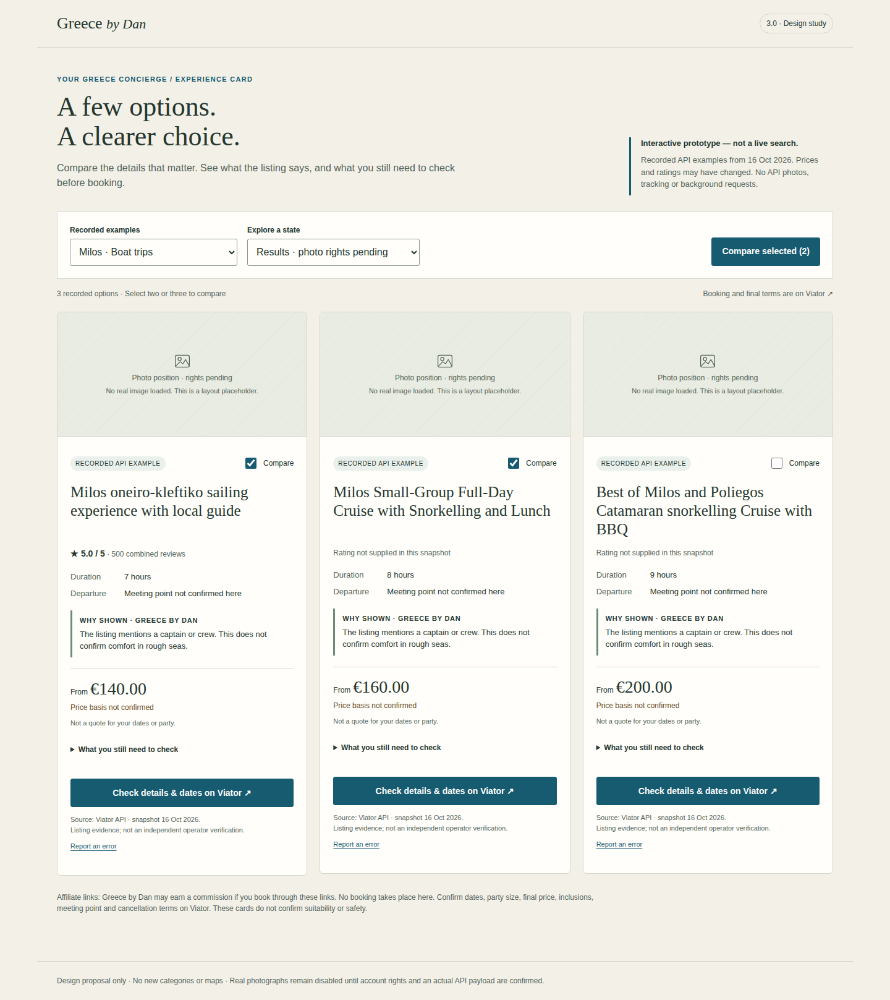

# Greece by Dan 3.0 — Experience Card / проект для утверждения

Статус: **проект интерфейса, без интеграции и публикации**. Ветка `design/experience-card-v3` создана от актуального `main` — `aa00b1d2c0c16985dd51e3431903f92000ccbf4b` (PR #21). Дата исследования: 16 октября 2026. Production, CMS, Worker, категории и карты не меняются.

Открыть `prototype.html` в обычном браузере. Это автономный HTML, без установки и сервера. Выберите Milos или Santorini, отметьте 2–3 карточки, нажмите Compare selected. Панель Explore a state показывает все состояния. Интерфейс на английском. Это записанные примеры и отдельно обозначенные fixtures, не live search. Никаких фоновых HTTP-запросов, хранения предпочтений, API-фото или аналитики. Партнёрские ссылки открываются только при явном клике. Отсутствующие URL не реконструируются.

## Рекомендация для утверждения

Одна общая карточка с последовательностью **название → рейтинг → длительность/отправление → почему показана → цена и её единица → неизвестные условия → Viator**. Фотография — необязательный слот, который не влияет на доступность текста или CTA. Пока права не закрыты, использовать компактный вариант без большого пустого фотоблока. В прототипе слот специально виден для обсуждения геометрии; он не предлагается как постоянная пустая иллюстрация в production.

Карточка помогает сравнить, но не называет тур «лучшим», безопасным или подходящим по медицинским/возрастным ограничениям. Рейтинг не означает нашу проверку оператора. Причины выбора — отдельный слой Greece by Dan с указанием доказательства, а не переписанное описание поставщика. Не выделять самый дешёвый тур: единицы рекламных сумм могут быть несопоставимы.

## 1. Реальные API-поля и разрешения

Из официального HTML Redoc локально извлечён OpenAPI `spec.data` (около 8,3 MB исходного HTML; без фотографий и без API-ключа). Проверены реальные схемы `ProductSummary`, `Image`, `ImageVariant`, `ItineraryDuration`, `ProductSearchPricing`, `ProductReviews`, `Logistics`, `ProductOptionLogistics`. Это проверка контракта, **не доказательство наличия поля в ответе нашего аккаунта**. Spec содержит обновление option logistics от 5 мая и pickup validation от 23 сентября 2026.

| Поле карточки | Источник Partner API | Что доступно сейчас / fallback |
|---|---|---|
| Идентификатор / название | `productCode`, `title` | Есть в реально проверенном `/search` нашего Worker. Без title/code карточку не публиковать. |
| Фото | `images[].imageSource`, `isCover`, `caption`, `variants[].url/width/height` | Есть в контракте ProductSummary. Наш DTO возвращает null при OFF: это не доказательство отсутствия upstream images. Фактический payload и права аккаунта пока не подтверждены. |
| Длительность | `duration.fixedDurationInMinutes` либо `variableDurationFromMinutes/variableDurationToMinutes`; возможен `unstructuredDuration` | Worker уже отдаёт `durationMinutes`. Диапазон сохранять диапазоном; null — “Duration not supplied”. Не складывать время остановок. |
| Отправление | Полный Product: `logistics.start[]`, `travelerPickup`; option-level `productOptions[].logistics` при наличии имеет приоритет | В ProductSummary logistics **нет**. Текущий DTO `departure=null`. “Meeting point not confirmed here”. Destination — не отправление. `location.ref` требует разрешения через locations endpoint, не является адресом. |
| Рекламная цена | `pricing.summary.fromPrice`, `pricing.currency` | Реальные EUR-суммы доступны. `priceBasis=unknown` сохраняется. Контракт нормализованной fromPrice не превращает `UNIT` / “private” в цену всей лодки/группы. Не обещать цену выбранных дат/состава. |
| Рейтинг | `reviews.combinedAverageRating`, `totalReviews`, `sources[].provider` | Суммарный рейтинг/count доступны DTO. Sources пока не передаются; нельзя маркировать всё как “Viator verified reviews”. Нет rating/count — “Rating not supplied”. |
| Почему показана | Собственная детерминированная причина + путь поля-доказательства | Не поле API “suitability”. Подпись “Why shown · Greece by Dan”. Отрицания/optional/extra-cost/conditional имеют приоритет. |
| Неизвестные условия | Отсутствующие данные + context-sensitive checklist | Не “not included”: null означает неизвестно. Опция, дата, party, pickup, возраст, доступность и cancellation требуют подтверждения. |
| Переход | `productUrl` | Передавать целиком без реконструкции slug/path/query. Нет/невалиден — CTA отсутствует или disabled. |
| Источник/время | Наши `fetchedAt`, `servedAt`, `evidenceLevel`; upstream `lastUpdatedAt` только если реально есть | Дата получения не равна дате проверки оператором. В прототипе — snapshot 16 Oct 2026, не “verified today”. |

**Проверка аккаунта:** исходники называют подключение Basic Access; работающие production/staging search и taxonomy подтверждены в предыдущем этапе. PID в реальных URL — P00320497. Однако dashboard доступа, действующая версия принятого аккаунтом соглашения и успешные ответы `/products/{code}` / `/locations/bulk` здесь не доступны. Поэтому точный account tier, дополнительные разрешения и фактические upstream images — **UNCONFIRMED**, не PASS. Нет основания объявлять Full Access или доступ к traveler photos. Секреты не запрашивались и не считывались.

Basic по публичной таблице поддерживает single-product content, search summaries, review ratings/counts; Full требует approval/certification и расширяет bulk/reviews/traveler photos. Публичная таблица — описание продукта, не снимок прав этого аккаунта. Консьерж остаётся referral integration, без booking/payment endpoints.

## 2. Изображения: что установлено и что ещё нужно

Официальный Front-End Guide прямо предусматривает supplier images из product data и отдельный источник traveler photos. В ImageSourceType найдены SUPPLIER_PROVIDED и PROFESSIONAL. Текущий helper выбирает cover, но **не проверяет imageSource**: перед будущим включением это нужно исправить. До этого обе gates остаются OFF.

VPP General Terms 3.1–3.2 и Affiliate Service Terms B-1.1–B-1.5 дают ограниченную отзывную лицензию для продвижения продуктов на Partner Site, с соблюдением документации. Это не свободная лицензия на любые фото Viator.com. Пометка CC BY 4.0 у API-документации относится к документации, не к product photographs. Страница Resource Center “Terms and Conditions” о Contributor campaign не подменяет договор Affiliate API.

Минимальный gate перед фото:

1. Владелец открывает свой Viator Partner dashboard и подтверждает account API level и Partner Site `greecebydan.com`; сохраняем дату/версию применимого соглашения и условия изображения. Скриншот — без ключей, токенов и личных реквизитов. Если положения неоднозначны, уточнить у affiliateapi@tripadvisor.com: supplier cover на comparison SRP, CDN embedding, responsive variants/crop, credits, caching/retention, noindex и короткие отдельно маркированные editorial reasons. Письма автоматически не отправляем.
2. Изолированный staging probe с существующим server-side secret возвращает **только** HTTP status, endpoint, product code, наличие полей, imageSource, размеры вариантов, наличие caption/credit и при необходимости hostname. Не раскрывает ключ, request headers, raw logs или персональные данные. Не скачивает саму фотографию. Проверить search, один product detail и locations только при необходимости; HTTP 200 одного endpoint не доказывает доступ ко всем.
3. Разрешённый supplier cover, реальные URL/размеры и необходимый credit прошли проверку. PROFESSIONAL и traveler photos исключены до отдельного подтверждения. `isCover` не означает автоматически “supplier”.
4. До письменного/документированного подтверждения не добавлять proxy, скачивание в repo/CMS, image optimization service, persist/cache изображений или замену CDN URL. После подтверждения — только URL конкретных API variants, исходное соотношение сторон или согласованный crop. Не переносить подписи/водяные знаки. Credit из разрешённых данных; не выдумывать “Photo © Viator”, если правообладатель неизвестен. При отсутствии обязательного credit фото не показывать.
5. Определить refresh/invalidation по применимым правилам supplier images. Рекомендацию weekly для traveler review photos нельзя переносить на supplier covers. Отключение прав/удаление продукта должно удалять отображение. Учесть IP/referrer передачу CDN в privacy. Никаких preload/preconnect к CDN при OFF.

General Terms 3.2 широко требует полноты/неизменности Product Information и non-indexing. Front-End Guide отдельно допускает компактные SRP и рекомендует полный PDP. Для summary card с outbound CTA не копировать полный PDP на сайт; согласовать спорные вопросы полноты, editorial reasons и noindex с Viator. До ответа не выдаём наши формулировки за проверенные Viator. Это ограничение будущего внедрения, не утверждение о нарушении опубликованного сайта.

## 3. Контракт карточки (проект, не изменение Worker)

```ts
type Evidence = { source: 'viator_api' | 'greece_by_dan'; path?: string;
  fetchedAt: string | null; level: 'api_reported' | 'editorial_inference' | 'unknown' };
type ExperienceCard = {
  productCode: string; title: string; affiliateUrl: string;
  image: null | { url: string; width: number; height: number;
    source: 'SUPPLIER_PROVIDED'; caption: string | null; credit: string | null };
  imageState: 'disabled' | 'rights_pending' | 'missing' | 'ready' | 'failed';
  duration: null | { minMinutes: number; maxMinutes: number };
  departure: null | { text: string; scope: 'product' | 'selected_option'; optionCode: string | null };
  price: null | { amount: number; currency: string;
    basis: 'per_person' | 'per_group' | 'unknown'; basisEvidence: Evidence | null;
    kind: 'indicative_from'; quote: false };
  rating: null | { average: number; count: number; providers: string[] | null };
  reasons: { text: string; evidence: Evidence }[];
  unknowns: { key: string; label: string }[];
  provenance: { endpoint: string; fetchedAt: string | null; servedAt: string | null };
};
```

Ноль не превращать в неизвестное, но нулевая цена не означает “Free” без подтверждения. `rating=0`, count=0 — “No rating supplied”, не ноль звёзд. Проверять finite/range и integer count. Старый DTO совместим через frontend adapter; EUR сейчас известен из request+server validation, для универсальности currency нужно передавать явно. `fetchedAt` ставится при получении upstream, не при каждом cache hit. У hard-coded цены нет provenance live.

Для будущих History/Food достаточно `reasons` и `unknowns` без новых типов карточек. History: подтверждён ли admission, guided access и physical effort. Food: diet/allergens, alcohol/age и конкретные inclusions. Это только extension points: классификация, фильтры, категории, меню и данные этих направлений в этом PR не создаются.

## 4. Responsive UX и состояния

- Mobile 320–700px: одна колонка, полный заголовок без обрезки; маленький photo slot/thumbnail только когда разрешён; длительность, неизвестное отправление и price basis видны сразу. Остальные неизвестные условия — disclosure, CTA минимум 44px. Цена не прячется в accordion; booking warning остаётся вне него.
- Desktop >=1001px: три колонки, до трёх выбранных вариантов; более широкий фотослот, те же факты и явное объяснение. 701–1000px — две колонки. Не делать всю карточку ссылкой: checkbox, disclosure и CTA независимы.
- Сравнение: две или три выбранные карточки, одинаковые строки фактов, без победителя по цене и без суммирования несовместимых единиц. На мобильном таблица прокручивается внутри подписанной focusable region; страница не уезжает горизонтально. Названия колонок остаются полными. Возврат возвращает focus на кнопку.
- Loading: aria-busy + короткий status, skeleton без fake price/rating. Не объявлять каждую skeleton-плашку screen reader. Сохранять предыдущий список при re-query только как явно устаревший и не смешивать с новой выдачей.
- No image / image failure: текст+CTA остаются; broken image исчезает, повторных циклических запросов нет. Rights pending не называть “no image supplied”.
- Missing data: null с точной подписью, никаких invented адресов, длительности, цен или рейтингов. Без подтверждённого affiliate URL нет активного CTA. В production без title/code результат отбрасывается.
- No results: объяснение, ссылка на изменение предпочтений; hard restrictions автоматически не ослабляются.
- API error: отличать от пустой выдачи, сохранить preferences, manual retry без бесконечного polling; учитывать 429 Retry-After, у 401/403 generic user message и server diagnostic без секретов. Не превращать network failure в “No tours available”.

## 5. Скорость, доступность, атрибуция

Это acceptance targets, не уже измеренные production показатели:

- Без нового framework, web fonts, icon CDN или image carousel. Добавочный JS <=10 KiB gzip, CSS <=5 KiB gzip; прототип не равен production bundle budget.
- После ответа Worker p95 DOM render <=100ms для трёх карточек на целевом среднем телефоне. Не обещать SLA upstream. Сохранить текущую cancellation/timeout обработку; ручной retry, отсутствие search-on-every-keystroke.
- Field Core Web Vitals при достаточном трафике: p75 LCP <=2.5s, INP <=200ms, CLS <=0.1. Снимать по реальной мобильной сети после внедрения; прототип не доказывает CWV.
- При фото — только подходящий реальный variant, width/height, согласованные srcset/sizes, lazy ниже viewport. Цель <=100KiB на thumbnail, но если разрешённых вариантов нет, не proxy-recompress; ограничить/не показывать фото. Никаких N+1 product detail запросов на initial list. Максимум один detail запрос при явном раскрытии; cache lifetime по действующим условиям, bounded concurrency и rate-limit fallback.
- WCAG 2.2 AA: текст 4.5:1, крупный 3:1; проверка focus/клавиатуры, control names, landmarks, headings, 200%/400% zoom и reflow 320 CSSpx. Не использовать только цвет/звёзды. Никакой автоматической анимации, уважать reduced motion. Фото с информационным смыслом получает текст из разрешённых реальных данных; если дублирует title и не добавляет смысла — alt="". Не выдумывать описание сцены.
- API `productUrl` сохраняется byte-for-byte в href; allowlist HTTPS Viator host, без userinfo. Никаких slug reconstruction, query stripping, redirect tracker или user identifiers в campaign. Campaign при необходимости задаётся API `campaign-value` фиксированным значением без PII.
- `rel="sponsored noopener noreferrer"`, ясное “Check details & dates on Viator ↗”, доступное предупреждение новой вкладки. Disclosure до клика. Не “Book now” и не “Available”. Переход не зависит от telemetry. Сохранность параметров не равна доказательству commission settlement.
- API content остаётся runtime; не добавлять его в indexable editorial HTML/JSON-LD/sitemap. До интеграции определить non-indexing strategy с Viator: JavaScript и robots Disallow сами по себе не гарантируют non-indexing. Для comparison view предпочтителен отдельный noindex ответ/route, без смены editorial canonicals.

## 6. Минимальный план внедрения после утверждения

1. Утвердить структуру/тексты по автономному прототипу; сохранить фото OFF. В этом PR — только docs/prototype/QA workflow, нет внедрения.
2. В существующем concierge.js выделить небольшие pure функции adapter + renderer; переиспользовать form/context/AbortController, не менять URL сайта/CMS/OAuth. Добавить comparison с ephemeral Set, без localStorage и событий.
3. Additive Worker DTO: currency, review providers, fetchedAt, evidence paths и image state. Сохранить текущие поля на переходный период. Причины — консервативные и отдельно маркированные. Исправить imageSource gate **до** разрешения фото. Не менять поиск Boat/Wine ради универсальной формы.
4. Отправление пока unknown. После подтверждения endpoint access можно сделать ограниченное enrichment по действию пользователя; учитывать option logistics. Не добавлять карты/координаты/расписания. Не трогать Decap: разрешённые API-фото не становятся CMS uploads.
5. Regression: existing tests + missing/invalid DTO, mixed currencies/price bases, exact affiliate URL preservation, rating source, image rights OFF, failed image, keyboard/focus, retry/429, long title/zoom/320px. Staging с настоящими ответами и проверкой Network отдельно от fixtures. API photos/events остаются выключенными.
6. Отдельное утверждение implementation PR, затем staging/production permission. Этот design PR не запускать через ручной старый Pages workflow: его workflow_dispatch может публиковать ветку. Новый design workflow только тестирует file:// и сохраняет screenshots, без deploy и без секретов.

## 7. Проверки / ограничения

Прототип воспроизводится в CI на Chromium с viewports 360/390/768/1440; сценарии и скриншоты — `verify.cjs`, artifact `experience-card-design-evidence`. Это responsive viewport, не физические iOS/Android и не полноценный accessibility audit. Итог конкретного CI run фиксируется в PR. Отдельная проверка работающего Viator API выполнена в предыдущем этапе; этот offline прототип её не подменяет.

Нужно от владельца перед фото/обогащением: доступный без секретов экран account tier + применимые image rules, затем безопасный staging field probe. **Для утверждения дизайна это не блокер. Для включения API-фото — блокер.**

## Источники (официальные, проверены 16 Oct 2026)

- [Partner API contract](https://docs.viator.com/partner-api/technical/) — ProductSummary/Image/Logistics и option override.
- [Basic / Full access](https://partnerresources.viator.com/travel-commerce/levels-of-access/) — публичная матрица endpoint capability.
- [Front-End Guide](https://partnerresources.viator.com/travel-commerce/front-end/) — SRP, product images, PDP.
- [VPP General + Affiliate Terms](https://partners.viator.com/static/docs/Viator-Partner-Program-Terms-en_EN.pdf) — General 3.1–3.2, 3.7, 3.9–3.11; B-1.1–B-1.5. Проверить принятую аккаунтом редакцию и дополнительные условия.
- [Traveler photos](https://partnerresources.viator.com/travel-commerce/traveler-photos/) — отдельный review endpoint / non-indexing; weekly recommendation относится к этим фото.
- [Affiliate attribution](https://partnerresources.viator.com/blog/attribution/) — productUrl/campaign.
- [Pricing guide](https://partnerresources.viator.com/travel-commerce/pricing/) — нормализованная from price vs bookable unit pricing; не вычислять group price из рекламного summary.
- [WCAG 2.2](https://www.w3.org/TR/WCAG22/) и [Core Web Vitals](https://web.dev/articles/vitals) — нормативные/инженерные targets.

## Готовые материалы и результаты

- [Интерактивный прототип](prototype.html) — скачать и открыть в браузере.
- [Desktop 1440px](evidence/cards-1440.png), [Mobile 390px](evidence/cards-390.png).
- [Сравнение desktop](evidence/compare-1440.png), [сравнение mobile](evidence/compare-390.png).
- [Loading](evidence/state-loading-390.png), [No image](evidence/state-no-image-390.png), [Missing data](evidence/state-missing-390.png), [No results](evidence/state-empty-390.png), [API error](evidence/state-error-390.png).
- [Проверки прототипа](evidence/results.json): PASS на 360/390/768/1440px; 2/3 comparison, нет page overflow, state recovery, affiliate attributes, ноль HTTP-запросов.
- [Design CI](https://github.com/onelionstudio-alt/greecebydan/actions/runs/38938038130): SUCCESS. Скриншоты визуально проверены. Физические телефоны не использовались.


